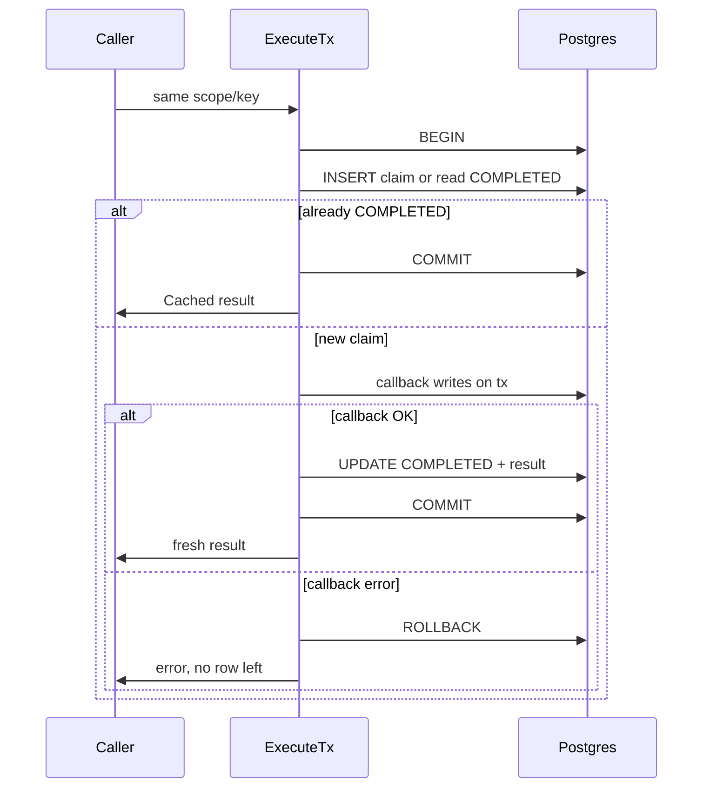
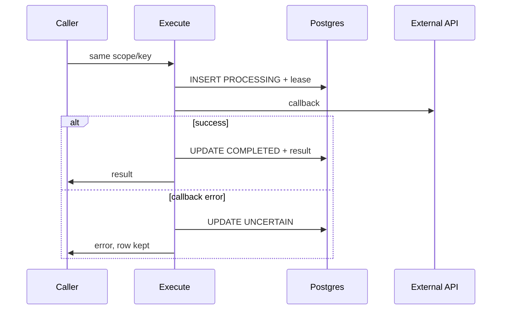

# PostgreSQL idempotency for Go

Generic `Idempotency[T]` backed by `idempotency.tbl_idempotency_records`. Initialized with `*sql.DB` (stdlib from `pgxpool` is fine).

## Setup

1. Apply `migrate.IdempotencyInstructions()` (via-jeri: `go run ./cmd/db reset` from `api/`).
2. DDL source: [`schema.yaml`](schema.yaml) → `pnpm schema:gen` / `go run ./cmd/schemagen …`.

## Keys and fingerprints

```go
req := idempotency.Request{
    Scope:       "tenant-42:booking:create", // tenant + operation namespace
    Key:         paymentID,                  // stable per business effect (not per HTTP attempt)
    Fingerprint: fp,                         // hash of immutable request fields
}
fp, _ := idempotency.Fingerprint(payload)
```

- **Key** — same key on retries (Temporal activity, client retry). Do not generate a new UUID per attempt.
- **Fingerprint** — if the same key is reused with different payload semantics, callers get `ErrConflict`.

## `ExecuteTx` vs `Execute`

Both deduplicate **successful** outcomes: a second call with the same `(scope, key, fingerprint)` returns the stored JSON result with `Cached: true` and does not run your callback again.

They differ in **what happens when the callback fails** and **what work belongs in the callback**.

### `ExecuteTx` — Postgres-only work in one transaction

```go
result, err := engine.ExecuteTx(ctx, req, func(ctx context.Context, tx *sql.Tx) (Booking, error) {
    // ALL database writes must use tx.
    _, err := tx.ExecContext(ctx, `INSERT INTO booking.tbl_bookings …`, …)
    return Booking{ID: id, Status: "CONFIRMED"}, err
})
```

**Flow**

1. `BEGIN`
2. `INSERT` idempotency row `PROCESSING` (or, on conflict, read existing `COMPLETED` → return cache → `COMMIT`)
3. Run callback using **`tx`**
4. `UPDATE` row to `COMPLETED` + store JSON result
5. `COMMIT`

**If the callback returns an error:** `ROLLBACK` removes the idempotency claim **and** any rows the callback wrote on `tx`. Nothing remains for that attempt. That is deliberate: a retry with the **same key** starts clean (no `UNCERTAIN`, no stuck `PROCESSING`).

**What ExecuteTx is for**

- Handlers that only mutate Postgres (create trip, assign driver, insert ledger row).
- You want **all-or-nothing**: business row + “this key finished” marker appear together.
- Duplicate delivery after success must not double-insert.

**What ExecuteTx is not for**

- Calling Stripe, S3, Temporal `ExecuteWorkflow`, or email inside the callback.
- Remembering failed attempts in the idempotency table (use logs/metrics or a separate audit table).



### `Execute` — claim first, then external or mixed side effects

```go
result, err := engine.Execute(ctx, req, func(ctx context.Context) (Booking, error) {
    return paymentProvider.Charge(ctx, req.Key, amount) // may commit outside your DB
})
```

**Flow**

1. Autocommit `INSERT` claim `PROCESSING` + **lease** (`dt_lease_until`)
2. Run callback **outside** a business transaction
3. On success: autocommit `UPDATE` → `COMPLETED` + JSON result
4. On callback error: autocommit `UPDATE` → **`UNCERTAIN`** (charge might have succeeded)

**If the callback fails:** a row **stays** in the table. The library cannot know whether an external API partially succeeded. Callers must **reconcile** (query provider with the same idempotency key), then `ResolveCompleted` or `AllowRetry` — not blind retry.

**While `PROCESSING` and lease active:** duplicate callers get `ErrInProgress`. After lease expiry without completion, duplicates get `ErrUncertain`.

**What Execute is for**

- Payment gateways, webhooks, object storage, starting workflows, any effect that is not rolled back with your Postgres transaction.



### Comparison

| | **ExecuteTx** | **Execute** |
|---|----------------|-------------|
| Callback | `(ctx, *sql.Tx) → T` | `(ctx) → T` |
| Side effects | Postgres only, on `tx` | External APIs allowed |
| Success | One commit: business + idempotency | Claim then complete in separate statements |
| Callback error | Full rollback, **no row** | Row → **`UNCERTAIN`** |
| Safe retry same key after error | Yes (nothing left) | No until reconcile / `AllowRetry` |
| Duplicate after success | Cached `T`, `Cached: true` | Same |
| Lease | No | Yes, while `PROCESSING` |

## Reconciliation APIs

- **`Inspect`** — current `status`, timestamps, lease (operations tooling).
- **`ResolveCompleted`** — after you **verified** external success (e.g. GET payment by idempotency key).
- **`AllowRetry`** — delete stale `UNCERTAIN` / expired `PROCESSING` only when you proved retry is safe.
- **`DeleteExpiredCompleted`** — optional TTL cleanup when `dt_expires_at` is set (default leaves NULL = retain forever).

## Safety (read this)

- No universal exactly-once across DB + arbitrary HTTP.
- Leases detect stuck work; they do not fence external side effects.
- JSON serialization: use stable, versioned result shapes.

## Testing

**Unit (no DB)**

```bash
cd appkit/go && go test ./idempotency/... -count=1
```

**Integration** (Postgres migrated, unique test keys)

```bash
VIA_JERI_DATABASE_PORT=15433 go run ./cmd/db reset   # from via-jeri/api
cd appkit/go && VIA_JERI_DATABASE_PORT=15433 go test -tags=integration ./idempotency/... -count=1
```

Integration tests document:

- `TestExecuteTx_SuccessThenCached` / `TestExecuteTx_FailureLeavesNoRow`
- `TestExecute_SuccessThenCached` / `TestExecute_FailureMarksUncertain`

Or set `APPKIT_TEST_DATABASE_DSN` to a full URL.
